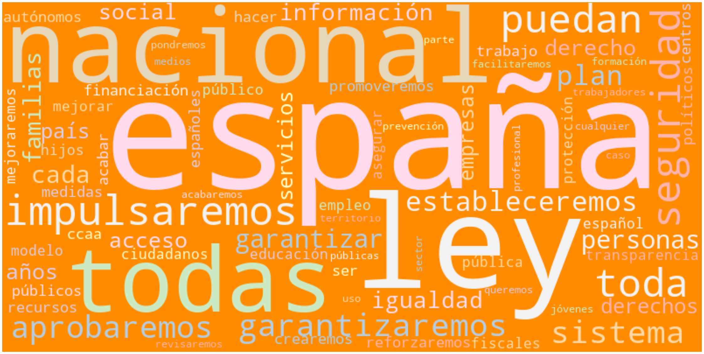
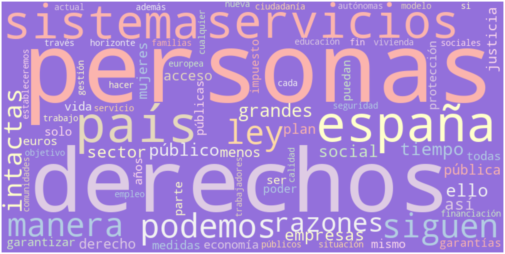
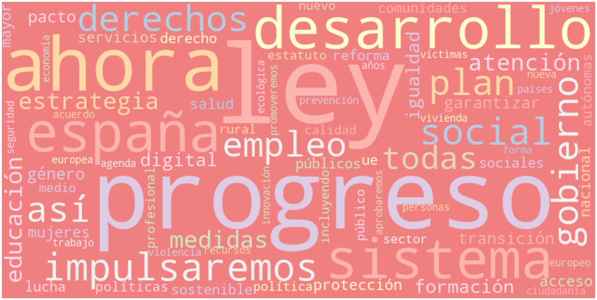
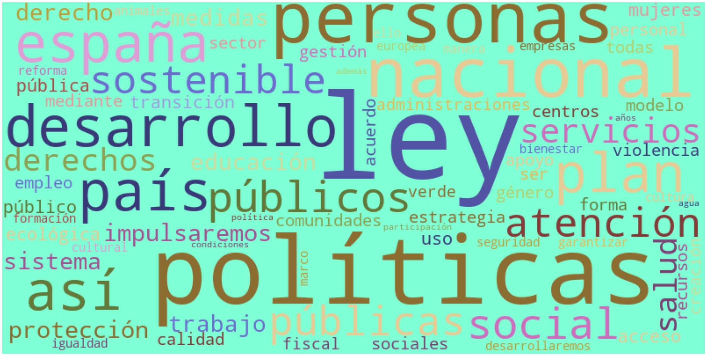
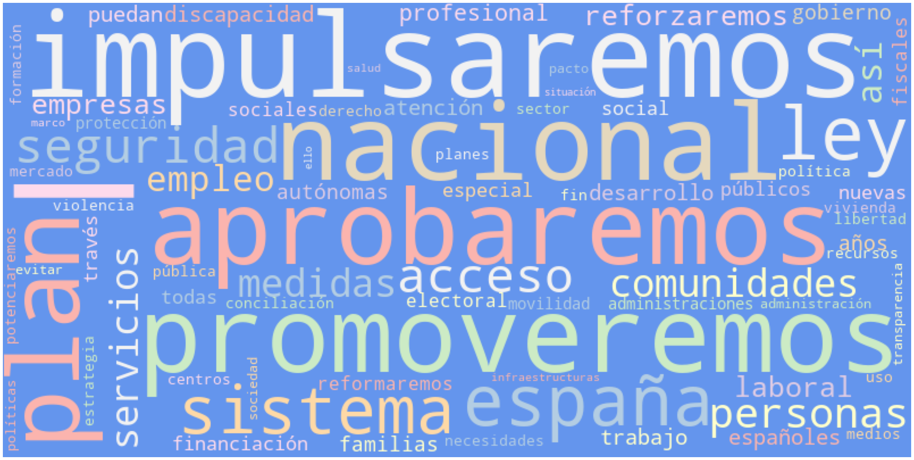
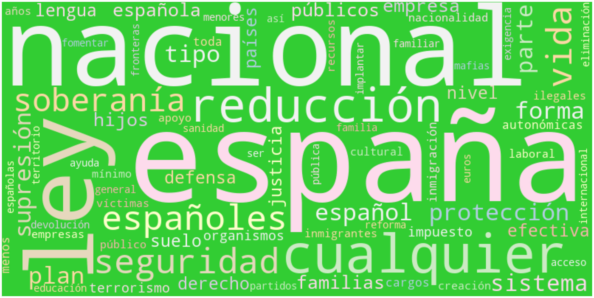

# PoliticAI

Gráficos interactivos de los análisis del [repositorio PoliticAI](https://github.com/Morante-tech/PoliticAI).

## Elecciones generales en la Comunidad de Madrid

Partido ganador en cada municipio:

- [Junio de 1977](elecciones_madrid/elecciones_madrid_197706.html)
- [Marzo de 1979](elecciones_madrid/elecciones_madrid_197903.html)
- [Octubre de 1982](elecciones_madrid/elecciones_madrid_198210.html)
- [Junio de 1986](elecciones_madrid/elecciones_madrid_198606.html)
- [Octubre de 1989](elecciones_madrid/elecciones_madrid_198910.html)
- [Junio de 1993](elecciones_madrid/elecciones_madrid_199306.html)
- [Marzo de 1996](elecciones_madrid/elecciones_madrid_199603.html)
- [Marzo de 2000](elecciones_madrid/elecciones_madrid_200003.html)
- [Marzo de 2004](elecciones_madrid/elecciones_madrid_200403.html)
- [Marzo de 2008](elecciones_madrid/elecciones_madrid_200803.html)
- [Noviembre de 2011](elecciones_madrid/elecciones_madrid_201111.html)
- [Diciembre de 2015](elecciones_madrid/elecciones_madrid_201512.html)
- [Junio de 2016](elecciones_madrid/elecciones_madrid_201606.html)
- [Abril de 2019](elecciones_madrid/elecciones_madrid_201904.html)
- [Noviembre de 2019](elecciones_madrid/elecciones_madrid_201911.html)

## Programas electorales de noviembre de 2019

Nubes de palabras de cada programa:

### Ciudadanos

### Podemos

### PSOE

### Más País

### PP

### Vox

